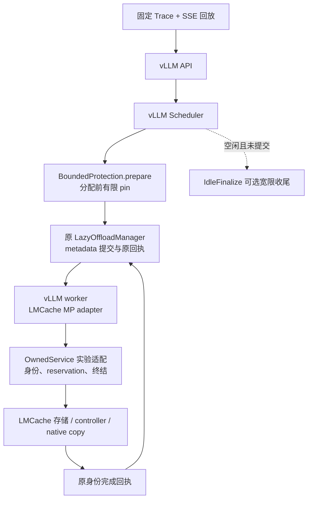

# 当前实现与证据导航

21:29更新：新组合共享取消/实际共享受害请求抢占两个GPU专项通过联合审计：完整请求各347，另1取消流/4压力取消流；936/504层KV全等，generation348/351精确闭合，引用2→1→0、最终pin0、BlockPool909。共享取消格正常teardown后出现output_handler traceback与CUDA IPC警告，单列保留，不宣称无错误。下一步限定准入汇总及新策略pilot预注册；不直接formal。见 [报告](experiments/2026-10-12/GENERATION_SHARED.md)。

21:21更新：新组合两个独立GPU专项完成：长prefix348请求/1800层KV全等、9次拆分/8条完整四chunk来源链；失败回执348请求/864层全等、1次真实STORE成功后报告失败。各格generation闭合、pins0、BlockPool909；独立复算与原始SHA归档通过。下一步共享取消和实际抢占；本次不是长suffix失败联合验证，也无性能结论。见 [长prefix](experiments/2026-10-12/GENERATION_PROTECTION_LONG_PREFIX.md) 与 [失败回执](experiments/2026-10-12/GENERATION_PROTECTION_FAILED_RECEIPT.md)。

21:11更新：真实模型服务提交后主机异常专项完成：a缺失败snapshot不通过；将只读证据前移至异常捕获后，b证明EngineCore/API自行退出、16个保护引用未误回滚、目标未END、未完成票据落盘。本地独立复算通过；服务器879 passed/115 subtests，本地审计18 passed单列。下一步长prefix、取消抢占、失败回执GPU专项；无性能或自动恢复结论。见 [服务故障报告](experiments/2026-10-12/GENERATION_PROTECTION_SERVICE_FAULT.md)。

21:04更新：新组合正常GPU诊断zero/one/two三格通过，共1,044请求，KV层比较720/720/864全部bitwise相等；one/two保护STORE11/9，最终pins为零、BlockPool各909 free，348代/格精确END。a轮缺observer状态证据失败保留；b原始文件与服务器字节一致，本地独立重算通过。下一步实际EngineCore故障退出/终态snapshot及长prefix、取消抢占、失败回执；无性能结论。见 [GPU报告](experiments/2026-10-12/GENERATION_PROTECTION_GPU.md)。

20:52更新：真实双候选正常/第二次注册前后失败契约及shutdown失败证据保存完成；全套显式CUDA/native **878 passed、115 subtests**。首轮fixture sequence冲突失败已保留，修复测试身份后通过。下一步独立服务GPU诊断及真实EngineCore故障退出验证，尚无新组合模型服务/bitwise结果。见 [报告](experiments/2026-10-12/GENERATION_PROTECTION_FAULTS.md)。

新增独立入口 `scripts/generation_protection_connector.py:GenerationProtectionConnector`，显式generation_protection opt-in；helper绑定、原metadata拼接和回执贯通。共享父类仅增加默认工厂；旧GenerationLedgerConnector仍限zero。`tests/test_generation_protection_connector.py`有12项回调/故障测试，最终全套873 passed。服务GPU尚未准入，见 [报告](experiments/2026-10-12/GENERATION_PROTECTION_WIRING.md)。

新增 CPU 候选：`scripts/generation_protection_bridge.py` 的 `ProtectionGenerationLedger`、`GenerationProtectionBridge` 和 `GenerationBoundedProtection`；原 ticket→prefix、派生 suffix lineage、原 batch receipt 和 poison 隔离由 `tests/test_generation_protection_bridge.py` 验证。18项新组合测试、合计60项真实库回归通过；服务 bind 仍明确禁用，旧零保护 Connector 未改。见 [报告](experiments/2026-10-12/GENERATION_PROTECTION_CONTRACT.md)。

更新：2026-10-12。帮助从项目目标读到实际代码；历史实验结果以各自冻结版本为准。

## 项目角色

CachePilot 是固定版本 vLLM/LMCache 上的外部实验 Connector、有限保护策略及独立所有权适配支线。模型推理、GPU KV block 管理和调度主体仍在 vLLM；哈希、CPU KV 存储、IPC 与 native copy 仍复用 LMCache。当前没有修改上游策略工厂，也不存在可直接 `pip install cachepilot` 的通用部署包。

该图描述控制关系；没有表示新增传输 kernel，也不意味着 Python 回执到达时刻等于 DMA 完成时刻。进程、锁与 native terminal 的完整关系见 [所有权支线](experiments/2026-10-01/OWNED_SERVICE.md)。

## 阅读顺序

| 问题 | 代码入口 | 应检查的不变量 |
|---|---|---|
| 请求如何回放 | `scripts/replay_trace.py`、`generate_trace.py` | 固定输入不使用本次生成文本；开放环入口等待可见；实际 token 校验 |
| 原版本哪里观测不足 | `scripts/allocation_pressure.py`、`allocation_connector.py` | 异步回载的物理块不能被零 compute token 步遗漏；证据与性能分开 |
| 哪些 KV 能保护 | `scripts/bounded_protection.py` | 已结束请求、完整 chunk、前缀从零、ref/hash/token proof、完整 footprint 预留 |
| 何时交给原 manager | `prepare` → `commit` → `receipts` | PREPARED 可回滚；已提交 pin 只随原回执释放；默认 drain 不重复提交 |
| metadata/回执身份 | `scripts/protection_connector.py`、`protection_handoff.py` | 一个 raw ID 同时至多一个批次；代际与原 batch identity 校验 |
| 同 raw ID 两代如何隔离 | `scripts/owned_service_connector.py`、`owned_service_protocol.py`、`owned_mp_connector.py` | client incarnation、sequence、generation 贯穿真实 RPC |
| TTL/取消/失联清理 | `scripts/owned_service.py`、`native/reservation_lock.cpp` | 原 reservation token、executor/CUDA native terminal 与资源使用期一致 |
| 空闲 pending STORE | `scripts/idle_finalize.py`、`idle_finalize_connector.py` | 只丢未提交 pending，宽限 15 秒；不触碰已提交 pin/batch；默认关闭 |
| 抢占后 STORE-only 代际 | `generation_ledger_connector.py`、`generation_manager_bridge.py` | LOOKUP 路由与 STORE 当前代分离；原获取 ticket、原 receipt；终结登记不漏代 |
| 何时允许逐代 END | `generation_session_ledger.py`、`generation_rpc_client.py`、`generation_idle_pump.py` | producer seal、所有旧 lookup future/原 STORE/RETRIEVE 完成；END 提交不等于 server ACK |
| 服务端是否真的闭合 | `generation_service_observer.py`、`audit_generation_pilot.py`、`audit_generation_ownership.py` | 只读原 END 返回、原 reservation/native terminal、物理 BlockPool 和 exact server sets |
| 公平配置对照 | `run_fixed_baselines.py`、`run_reference_baselines.py`、`run_arrival_matrix.py` | 源码/trace/配置冻结、pilot 准入、停止规则、无部分矩阵均值 |
| 结果能否独立复算 | `audit_replay_measurements.py`、`summarize_reference_matrix.py`、`verify_source_snapshot.py` | 重读原始时间戳/token/hash/资源/源码，不能仅相信通过标志 |

`IdleFinalizeConnector` 继承 `ProtectionConnector` → `HandoffObservedConnector` → `OwnedServiceConnector` → `OwnedMPConnector` → 外部 `LMCacheMPConnector`。零预算和非零保护共享相应的所有权路径；native 没有 LMCache 服务。全配置比较包含不同数据通路开销，不能把差异只归因于保护算法。

新 `GenerationLedgerConnector` 继承 `IdleFinalizeConnector`，要求显式 opt-in 且仅允许零保护。它是独立版本候选，并未替换既有非零保护入口。`GenerationManagerBridge` 包装原 manager 的 admission/drop/receipt；GPU pin 仍由原 manager 管理。新性能入口为 `run_generation_matrix.py`，长prefill保留原即时卸载 connector；decode192的独立新矩阵改用 opt-in `ImmediateReceiptConnector`，明确比较的是整套配置。

`ImmediateReceiptConnector` 直接继承 `OwnedServiceConnector`，不引入 lazy manager。`immediate_end_queue.py` 保留 exact wire END，收到原 worker 的 `finished_sending` 后一次提交；原 STORE future、copy 和 GPU free 均不替换。其 `immediate_receipt_end=true` 签名与旧 immediate 分开；只支持同步 TP1/零保护，抢占、worker unhealthy 和重叠 raw ID 复用 fail closed。只读定位入口是 `immediate_session_observer.py`、`audit_immediate_decode.py`，不负责修复服务状态。

真实匿名结构准备入口是 `catalogue_real_traces.py` → `prepare_real_structure.py` → `audit_real_structure.py`；固定源commit、全部准入session、实际模型tokenizer和来源SHA。只生成CPU请求结构，不推断物理压力或live Agent行为。

结构GPU准入入口为 `run_real_structure_pilot.py`，要求十二格decode receipt formal先完整通过，冻结输入和既有源码，新签名运行四个冷启动零保护配置。`audit_real_structure_pilot.py` 独立重读归档源文件、原始metrics采样和既有资源审计；缺指标为unknown，保留任何原始资源失败，单次诊断不输出正式性能聚合。实际GPU启动与结果以今日记录为准。

## 主线与开发支线

- 主线：真实分配信号诊断 → 准入前有限保护 → 同栈 zero/one/two → 固定参数调优与负载复核。
- 所有权支线：取消、迟到回执、TTL、client death、native terminal、原 token 释放。它是安全实验前置，不算作策略加速收益。
- 空闲收尾支线：原 2.5 GiB 资源残留导致停止，独立诊断后增加 opt-in 宽限机制，新栈重新预注册比较。旧失败仍保留。
- 方法与展示：源码签名、原始包 hash、独立时间戳审计、事后阶段描述、可重复离线复核。图表不代替原始证据。

## 当前可以展示的成果

已经实现并在真实单卡栈验证有限保护及多类生命周期边界；固定参数、容量和不同到达负载的对照已给出收益、退化与不触发的反例。目前不能声称稳定优于调优基线、真实 Agent 泛化、生产级容错或上游已接受修复。

展示顺序建议：解释一次真实失效及其证据；说明修复不变量和失败保留；再展示固定对照如何推翻“有命中就一定更快”的假设；最后讨论 reserve 的触发范围和进一步可验证的实验。数字以 [STATUS](STATUS.md) 和对应正式报告为准。

## 复现前置

实际服务需要 Linux、锁定 Conda/LMCache/vLLM 环境、模型，以及 `python scripts/build_reservation_native.py` 生成的 CPU reservation 扩展。该扩展复用 PyTorch 提供的 pybind11 头文件，用 C++17 编译，不是 CUDA copy kernel。性能、诊断和 full CUDA contract 必须串行执行。

最新离线入口见 [晚间复核说明](experiments/2026-10-11/REPRODUCE_EVENING.md)。当前支持范围限定单卡、同步 text-only、固定 full-attention 布局；多 worker、异步调度、真实 driver/DMA fault 与永久 I/O 自动恢复仍开放。
