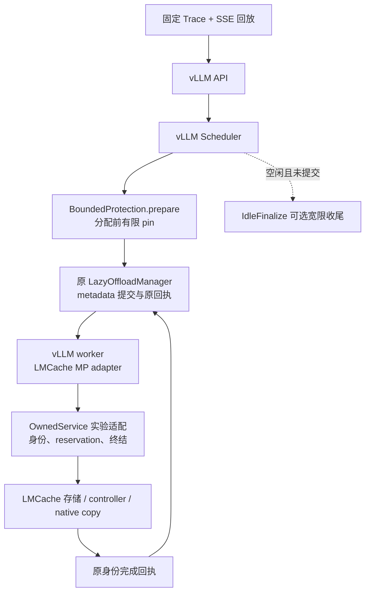

# 当前实现与证据导航

更新：2026-10-12。帮助从项目目标读到实际代码；历史实验结果以各自冻结版本为准。

## 项目角色

CachePilot 是固定版本 vLLM/LMCache 上的外部实验 Connector、有限保护策略及独立所有权适配支线。模型推理、GPU KV block 管理和调度主体仍在 vLLM；哈希、CPU KV 存储、IPC 与 native copy 仍复用 LMCache。当前没有修改上游策略工厂，也不存在可直接 `pip install cachepilot` 的通用部署包。

该图描述控制关系；没有表示新增传输 kernel，也不意味着 Python 回执到达时刻等于 DMA 完成时刻。进程、锁与 native terminal 的完整关系见 [所有权支线](experiments/2026-10-01/OWNED_SERVICE.md)。

## 阅读顺序

| 问题 | 代码入口 | 应检查的不变量 |
|---|---|---|
| 请求如何回放 | `scripts/replay_trace.py`、`generate_trace.py` | 固定输入不使用本次生成文本；开放环入口等待可见；实际 token 校验 |
| 原版本哪里观测不足 | `scripts/allocation_pressure.py`、`allocation_connector.py` | 异步回载的物理块不能被零 compute token 步遗漏；证据与性能分开 |
| 哪些 KV 能保护 | `scripts/bounded_protection.py` | 已结束请求、完整 chunk、前缀从零、ref/hash/token proof、完整 footprint 预留 |
| 何时交给原 manager | `prepare` → `commit` → `receipts` | PREPARED 可回滚；已提交 pin 只随原回执释放；默认 drain 不重复提交 |
| metadata/回执身份 | `scripts/protection_connector.py`、`protection_handoff.py` | 一个 raw ID 同时至多一个批次；代际与原 batch identity 校验 |
| 同 raw ID 两代如何隔离 | `scripts/owned_service_connector.py`、`owned_service_protocol.py`、`owned_mp_connector.py` | client incarnation、sequence、generation 贯穿真实 RPC |
| TTL/取消/失联清理 | `scripts/owned_service.py`、`native/reservation_lock.cpp` | 原 reservation token、executor/CUDA native terminal 与资源使用期一致 |
| 空闲 pending STORE | `scripts/idle_finalize.py`、`idle_finalize_connector.py` | 只丢未提交 pending，宽限 15 秒；不触碰已提交 pin/batch；默认关闭 |
| 抢占后 STORE-only 代际 | `generation_ledger_connector.py`、`generation_manager_bridge.py` | LOOKUP 路由与 STORE 当前代分离；原获取 ticket、原 receipt；终结登记不漏代 |
| 何时允许逐代 END | `generation_session_ledger.py`、`generation_rpc_client.py`、`generation_idle_pump.py` | producer seal、所有旧 lookup future/原 STORE/RETRIEVE 完成；END 提交不等于 server ACK |
| 服务端是否真的闭合 | `generation_service_observer.py`、`audit_generation_pilot.py`、`audit_generation_ownership.py` | 只读原 END 返回、原 reservation/native terminal、物理 BlockPool 和 exact server sets |
| 公平配置对照 | `run_fixed_baselines.py`、`run_reference_baselines.py`、`run_arrival_matrix.py` | 源码/trace/配置冻结、pilot 准入、停止规则、无部分矩阵均值 |
| 结果能否独立复算 | `audit_replay_measurements.py`、`summarize_reference_matrix.py`、`verify_source_snapshot.py` | 重读原始时间戳/token/hash/资源/源码，不能仅相信通过标志 |

`IdleFinalizeConnector` 继承 `ProtectionConnector` → `HandoffObservedConnector` → `OwnedServiceConnector` → `OwnedMPConnector` → 外部 `LMCacheMPConnector`。零预算和非零保护共享相应的所有权路径；native 没有 LMCache 服务。全配置比较包含不同数据通路开销，不能把差异只归因于保护算法。

新 `GenerationLedgerConnector` 继承 `IdleFinalizeConnector`，要求显式 opt-in 且仅允许零保护。它是独立版本候选，并未替换既有非零保护入口。`GenerationManagerBridge` 包装原 manager 的 admission/drop/receipt；GPU pin 仍由原 manager 管理。新性能入口为 `run_generation_matrix.py`，保留即时卸载的原 connector，明确比较的是整套配置。

## 主线与开发支线

- 主线：真实分配信号诊断 → 准入前有限保护 → 同栈 zero/one/two → 固定参数调优与负载复核。
- 所有权支线：取消、迟到回执、TTL、client death、native terminal、原 token 释放。它是安全实验前置，不算作策略加速收益。
- 空闲收尾支线：原 2.5 GiB 资源残留导致停止，独立诊断后增加 opt-in 宽限机制，新栈重新预注册比较。旧失败仍保留。
- 方法与展示：源码签名、原始包 hash、独立时间戳审计、事后阶段描述、可重复离线复核。图表不代替原始证据。

## 当前可以展示的成果

已经实现并在真实单卡栈验证有限保护及多类生命周期边界；固定参数、容量和不同到达负载的对照已给出收益、退化与不触发的反例。目前不能声称稳定优于调优基线、真实 Agent 泛化、生产级容错或上游已接受修复。

展示顺序建议：解释一次真实失效及其证据；说明修复不变量和失败保留；再展示固定对照如何推翻“有命中就一定更快”的假设；最后讨论 reserve 的触发范围和进一步可验证的实验。数字以 [STATUS](STATUS.md) 和对应正式报告为准。

## 复现前置

实际服务需要 Linux、锁定 Conda/LMCache/vLLM 环境、模型，以及 `python scripts/build_reservation_native.py` 生成的 CPU reservation 扩展。该扩展复用 PyTorch 提供的 pybind11 头文件，用 C++17 编译，不是 CUDA copy kernel。性能、诊断和 full CUDA contract 必须串行执行。

最新离线入口见 [晚间复核说明](experiments/2026-10-11/REPRODUCE_EVENING.md)。当前支持范围限定单卡、同步 text-only、固定 full-attention 布局；多 worker、异步调度、真实 driver/DMA fault 与永久 I/O 自动恢复仍开放。
