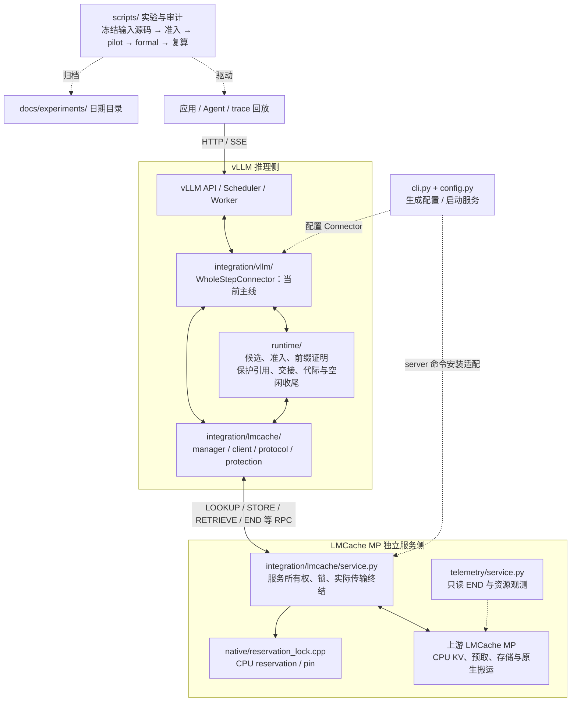
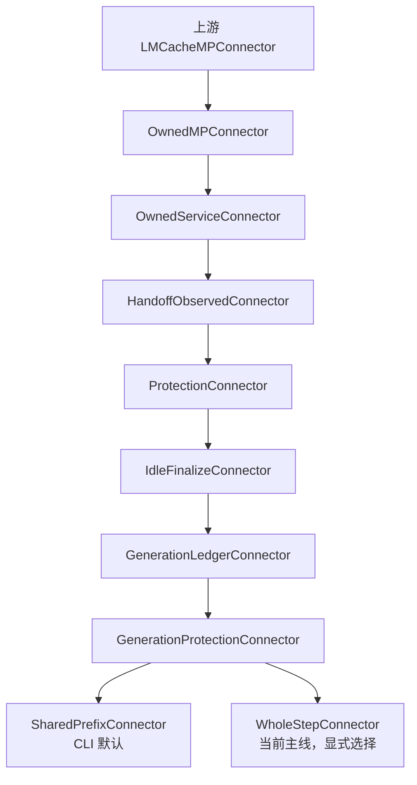

# CachePilot 当前项目结构图

按 2026-10-20、提交 `c4be973` 的实际代码整理。主线运行时位于
`src/cachepilot/`，当前实验选择 `WholeStepConnector`；CLI 默认仍选择
`SharedPrefixConnector`，通过 `config --whole-step` 显式切换。

## 文件组织

以下列出主要文件；`scripts/`、`tests/` 和证据目录仅展开代表性入口。

```text
CachePilot/
├── pyproject.toml                       包安装、cachepilot 命令、pytest 配置
├── src/cachepilot/                      运行时主干
│   ├── __main__.py                      python -m cachepilot
│   ├── cli.py                           config / doctor / manifest / server
│   ├── config.py                        SharedPrefixConfig / WholeStepConfig
│   ├── provenance.py                    实验源码清单与 SHA256
│   ├── native.py                        定位独立编译的 reservation 扩展
│   ├── runtime/
│   │   ├── candidates.py                候选过滤与排序
│   │   ├── admission.py                 准入接口、保守 reserve、chunk 预算
│   │   ├── whole_step.py                全请求包络与 WholeStepAdmission
│   │   ├── prefix_proof.py              token / hash / block 前缀证明
│   │   ├── protection.py                prepare / commit / rollback / receipts
│   │   ├── shared_prefix.py             共享前缀的独立保护引用
│   │   ├── whole_step_protection.py     保留 bind 禁用的 CPU 研究候选
│   │   ├── handoff.py                   metadata / 原批次交接身份账本
│   │   ├── generation.py                代际与操作票据、END 就绪条件
│   │   ├── idle.py                      空闲时未提交 pending STORE 收尾
│   │   └── idle_pump.py                 空闲期间 generation 轮询
│   ├── integration/
│   │   ├── vllm/
│   │   │   ├── whole_step.py            当前主线 WholeStepConnector 服务入口
│   │   │   ├── shared_prefix.py         默认 SharedPrefixConnector 服务入口
│   │   │   ├── generation_protection.py 保护与 generation 组合接线
│   │   │   ├── generation.py           scheduler / worker 的代际接线
│   │   │   ├── idle.py                 空闲收尾接线
│   │   │   ├── protection.py           分配前保护、metadata 与原回执回调
│   │   │   ├── owned_service.py        client / sequence 所有权身份
│   │   │   └── owned_mp.py             继承上游 LMCacheMPConnector
│   │   └── lmcache/
│   │       ├── protocol.py             wire ID、所有权客户端、metadata 合并
│   │       ├── client.py               generation RPC 与异步结果轮询
│   │       ├── manager.py              包装上游 LazyOffloadManager 的生命周期
│   │       ├── protection.py           保护、原回执与代际 ticket 的桥接
│   │       ├── service.py              当前服务所有权、锁与 native transfer 终结
│   │       └── guard.py                独立 reservation guard 适配路径
│   └── telemetry/
│       └── service.py                   只读观察服务端 END 与资源状态
├── native/
│   └── reservation_lock.cpp             C++ CPU reservation / pin 扩展
├── scripts/                             实验、审计、探针、构建与旧路径兼容
│   ├── build_reservation_native.py       编译上述扩展
│   ├── prepare_real_structure.py         准备匿名会话结构输入
│   ├── replay_trace.py                  固定 trace 的 HTTP / SSE 回放
│   ├── run_whole_step_mainline.py        真实服务覆盖与同来源 KV 准入
│   ├── run_whole_step_matrix.py          zero / one / two 匹配比较
│   ├── run_whole_step_efficiency.py      早退 / 原生 deadline 的 pilot 与 formal
│   ├── run_whole_step_identity_diagnostic.py  身份与 source1 机制诊断
│   ├── audit_whole_step_matrix.py        实验资源、输入、计时与源码审计
│   ├── whole_step_sparse_probe.py        同来源 KV 稀疏探针
│   ├── source1_window_connector.py       source1 只读窗口诊断
│   └── shared_prefix_connector.py        示例：旧路径导入兼容入口
├── configs/                             固定基线、故障与历史实验配置
├── tests/
│   ├── architecture/                    包边界、入口同一性与源码冻结契约
│   ├── cachepilot_test_support/          公共测试构件
│   └── test_*.py                        模块、接线、真实栈与实验工具测试
├── examples/shared-prefix/              手工安装与双进程接线示例
├── docs/
│   ├── ARCHITECTURE.md                  模块边界与工程约束
│   ├── MAINLINE.md                      当前唯一实验问题与决策门槛
│   ├── PROJECT_PLAN.md                  分阶段计划
│   ├── TASKS.md                         推进记录与待办
│   └── experiments/<日期>/              报告、失败记录、冻结源与原始证据
├── runs/                                本机实验工作目录
├── artifacts/                           编译、下载、解包与分析产物
└── traces/                              本机轨迹工作目录
```

`runs/`、`artifacts/`、`traces/` 是工作目录，内容随机器与实验变化；需要长期
引用的证据按清单归档到 `docs/experiments/`。本地还可能存在构建生成的 `build/`。

## 模块与外部系统的关系

实线表示主要调用或控制交互，虚线表示配置、观测或实验驱动。图中 vLLM 与
LMCache 为外部依赖；CachePilot 的接入代码分别运行在推理侧和 LMCache 服务侧。



模型推理、请求调度主体与 GPU KV block 管理由 vLLM 执行；CPU KV 存储、
预取与 GPU↔CPU 搬运复用 LMCache。CachePilot 在这些边界增加保护决策、
引用与回执管理、代际隔离和资源终结处理。图中的 RPC 是控制关系，实际
KV 字节搬运由上游传输模块执行；C++ 扩展负责 reservation，并非自写 CUDA kernel。

当前代码并非严格单向分层：例如 `runtime/shared_prefix.py` 继承
`integration/lmcache/protection.py` 的类，而后者又使用 runtime 账本；
`prefix_proof.py` 也使用 vLLM 的工具。图中双向关系保留了这部分实际耦合。
`candidates.py`、`admission.py`、`whole_step.py` 的决策部分不导入上游推理栈。

## Connector 的真实继承关系

下面箭头从父类指向子类，表示继承，不是请求按顺序流过多个独立服务。



两个末端 Connector 是并列分支。WholeStep 的服务辅助类
`WholeStepServiceProtection` 复用 `SharedPrefixProtection` 的保护生命周期，
将 `admission_policy` 设为 `WholeStepAdmission`；显式服务接线位于
`integration/vllm/whole_step.py`。`runtime/whole_step_protection.py` 中
保留的 `WholeStepProtection.bind()` 仍拒绝服务接线，不能将二者混用。

## 当前主线运行的顺序

1. 实验脚本固定模型、输入、资源预算、配置和源码清单，分别启动 vLLM 与
   带 CachePilot 所有权适配的 LMCache MP 服务。
2. 应用或回放器向 vLLM 发请求；Scheduler/Worker 通过所选 Connector 接入。
3. 开启非零保护时，保护生命周期使用候选、准入、前缀证明等模块，执行
   分配前准备、保护引用、提交或回滚，并与原 manager 的 STORE 交接。
4. LOOKUP / STORE / RETRIEVE 沿原 LMCache 路径执行，服务侧适配维护真实
   消费者、锁和传输终结；原回执返回后，推理侧核对身份、释放保护引用。
5. generation 账本在相应操作终结后推进 END；空闲收尾和观测核对剩余资源。
6. 审计工具独立复算输入、计时、回执、资源、源码与证据 SHA，再生成报告。

最新已完成的 deadline 对照，两组都使用 `WholeStepConnector`，但
`max_chunks=0`，即零自定义保护；由实验入口把 LMCache 原生 deadline 配置为
0 或 0.5 秒。上述候选扫描与 pin 分支并不因此必然执行。CLI 的基础配置仍将
deadline 设为 0，并没有因为实验结果自动改成 0.5。

## 后续按模块修改的位置

| 需要修改的行为 | 主要代码位置 |
|---|---|
| 保护候选的过滤、优先级 | `runtime/candidates.py` |
| 整步预留、容量与 chunk 准入 | `runtime/admission.py`、`runtime/whole_step.py` |
| 共享引用、pin、回滚与原回执释放 | `runtime/shared_prefix.py`、`runtime/protection.py` |
| 前缀有效性与交接身份 | `runtime/prefix_proof.py`、`runtime/handoff.py` |
| 代际、RPC、END 与生命周期接线 | `runtime/generation.py`、两侧 integration 的 generation / manager / client 模块 |
| 服务所有权、reservation 与实际传输终结 | `integration/lmcache/service.py`、`native/reservation_lock.cpp` |
| 实验对照、诊断与离线审计 | `scripts/` 中对应入口，归档记录在 `docs/experiments/` |

上表 runtime / integration 路径均相对于 `src/cachepilot/`。原生 deadline 的
调度实现在上游 LMCache；当前仓库在 config 和实验入口选择其参数。
新的卸载选择规则需要先确定上游 policy / manager 接入边界，不能仅改保护候选
就当作改变了全部普通 STORE。运行时主干不导入 `scripts/`；历史兼容入口继续
转发到唯一实现，研究探针显式选择后才进入诊断流程。

相关导航：[模块边界](ARCHITECTURE.md)、[当前主线](MAINLINE.md)、
[实际接线示例](../examples/shared-prefix/README.md)、
[最新对照报告](experiments/2026-10-19/NATIVE_DEADLINE.md)。
