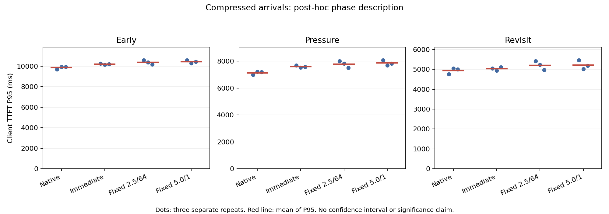

# 到达时间压缩 formal 结果

2026-10-11。按 [预注册](ARRIVAL_COMPRESSION_PREREGISTRATION.md) 执行，仅将 reference trace 的 `arrival_ms` 乘以 0.5；输入、68 请求、75,808 prompt tokens、48 decode tokens/请求、配置与资源预算不变。新 trace 规范化 SHA256 为 `fdad0152055b69331d98d8acf66c3926ce8b08ffbbe996a0d035756ccee92020`。

## 完成与失败记录

pilot b 四格通过后，formal 十二格、816 请求全部通过独立签名、token、原始时间戳、H2D、资源、退出与日志审计。服务器和本地复算 JSON 完全一致。pilot 不进入正式均值。

pilot a 因 SSH PATH 配置错误而在寻找 `bash` 时启动失败，没有模型请求；原目录保留。仅修正 PATH 后启动新的 pilot b，未改 workload 或门槛。formal 没有重跑筛选。

## 正式指标

每组各三次。TTFT P95 单位 ms，SD 为三次 P95 的样本标准差；所有精度完整保留在 JSON 中。

| 配置 | r0 | r1 | r2 | 均值 | SD | 相对 native |
|---|---:|---:|---:|---:|---:|---:|
| native | 9348.92 | 9586.01 | 9575.71 | 9503.55 | 134.01 | 0 |
| owned-immediate | 9898.81 | 9772.43 | 9829.61 | 9833.62 | 63.28 | +3.47% |
| h2.5/d64 | 10215.65 | 10019.99 | 9810.48 | 10015.37 | 202.62 | +5.39% |
| h5.0/d1 | 10182.93 | 9927.10 | 10055.65 | 10055.23 | 127.91 | +5.81% |

| 配置 | ready-to-end P95 ms | 会话跨度 P95 ms | server queue mean ms | prefill tokens | H2D bytes | D2H bytes 均值 |
|---|---:|---:|---:|---:|---:|---:|
| native | 10557.98 | 20011.97 | 4986.65 | 36,336 | 不适用 | 不适用 |
| owned-immediate | 10948.73 | 20136.13 | 5226.46 | 24,240 | 1,811,939,328 | 3,019,898,880 |
| h2.5/d64 | 11124.73 | 20304.85 | 5365.59 | 24,240 | 1,811,939,328 | 2,000,683,008 |
| h5.0/d1 | 11178.38 | 20302.81 | 5366.40 | 24,240 | 1,811,939,328 | 2,277,507,072 |

到达压缩后，所有配置的排队和 TTFT 均高于原到达矩阵。会话跨度反而缩短，因为计划等待时间也被压缩，不能将跨度缩短称为服务加速。四组本轮单独聚合，不与原 reference 合并。

native 仍有最低整体 TTFT，立即卸载在本轮低于两个 fixed；开发集选择的 h5.0/d1 未保持固定策略中最低的均值。n=3 不证明统计显著性，也不能据此重新选择生产默认参数。虽然三个缓存配置的实际 prefill 均比 native 少约 33.3%，整体延迟没有改善；减少重算本身不足以解释端到端效果。

## 事后请求阶段描述

沿用原 trace 的早期 48、压力 8、末轮回访 12 请求标签进行事后描述。不同标签请求的实际执行可重叠，不是互斥的服务时间片。

| 配置 | 早期 TTFT P95 ms | 压力 TTFT P95 ms | 回访 TTFT P95 ms |
|---|---:|---:|---:|
| native | 9863.29 | 7127.81 | 4935.87 |
| owned-immediate | 10209.74 | 7598.16 | 5034.69 |
| h2.5/d64 | 10385.30 | 7781.59 | 5206.73 |
| h5.0/d1 | 10436.26 | 7858.01 | 5222.49 |

未压缩 reference 中的末轮回访收益，在本轮标签组 TTFT 中没有复现。该观察和更高队列指标一致，但尚不能定量归因于排队、DMA、哈希或 Connector CPU 开销。没有据此调整策略或移除安全预留。

## 输出、日志、源码与证据

- 所有缓存配置相对同期 native 的输出 hash 有 2–4/68 差异；固定 token 数不保证相同 decode 文本，没有逐请求 KV probe。
- native r0/r2 各保留 8 行精确识别的退出 output-handler traceback；运行期无 fatal error，没有删除原日志。
- [formal 原始归档](arrival-half-evidence/arrival-half-formal-20261011a.tar.gz)：SHA256 `8ccb222f931101818eefe5b49237ee809c5ca71906e1effe55d0e6c5cd6577ea`。
- [formal 独立审计](arrival-half-evidence/arrival-half-formal-20261011a-independent.json)、[原始时间戳审计](arrival-half-evidence/arrival-half-formal-20261011a-timing.json)、[全部阶段重复](arrival-half-evidence/phase-description.json)。
- pilot b 原始包 SHA256 `9d1b4d24b0e81143760d755134400ec2bd061db3a7940bb601856def595d34d2`；[启动失败 a](arrival-half-evidence/arrival-half-startup-failure-20261011a.tar.gz) SHA256 `4b07e471278c5e965888638fa5cd7d7185dee9b3467f6a2ee98d13b1d3e6ae61`。
- [冻结运行源码](arrival-half-evidence/evening-frozen-source-20261011.tar.gz) SHA256 `52d180219ce7e5e9b25f1c578ca566c141f8b36c01d47e687225c3daffce0db5`；解压后逐字节验证 reference 的 173 项和 arrival 的 174 项全部匹配，附 [reference 校验](arrival-half-evidence/reference-source-verification.json) / [arrival 校验](arrival-half-evidence/arrival-source-verification.json)。此包记录实验实际源码，避免 Git 换行转换影响签名；不包含模型和安装包。

下一步优先解释保护零覆盖边界、复核原始软件回归，并设计更长 prefill 或不同 decode 比例的控制变量实验。以上证据不支持增加保护预算或租更大 GPU 后直接宣称性能改善。
