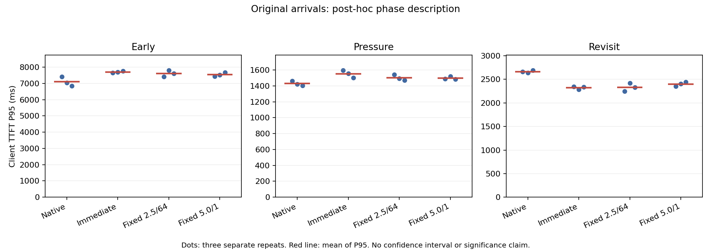

# 无保护参考 formal 结果

## 范围

这是在原保护 validation 因 `protect-one` 零覆盖而停止后，单独预注册的四组整套配置对照。它不改写原 validation，也不包含保护候选。固定 trace 为 68 个请求、75,808 prompt tokens、每请求 48 decode tokens；Qwen3-4B/BF16、RTX 4090 24GB、2 GiB GPU KV、16 GiB CPU KV、同步 eager。

## 验收与证据

四组各三次，共 12 格、816 请求。每格通过 HTTP/SSE、实际 token 数、源文件/trace/config 签名、原始时间戳复算、正常退出、H2D（缓存组）、LMCache owner/job/session/temporary/锁清零和 GPU unregister。native 的 CPU KV、H2D/D2H 与 protection receipt 按不适用处理，没有伪造资源值。

- formal 独立矩阵：`matrix_complete=true`，12/12 格通过。
- 原始归档 SHA256：`20bbabfa7a307e5f76fa299c6266d0b8454237b075c9e947ce594b5eb6138ca1`。
- 原始包：[unprotected-references-formal-20261011a.tar.gz](unprotected-reference-evidence/unprotected-references-formal-20261011a.tar.gz)
- 独立聚合：[unprotected-references-formal-20261011a-independent.json](unprotected-reference-evidence/unprotected-references-formal-20261011a-independent.json)
- 时间戳/token/hash 复算：[unprotected-references-formal-20261011a-timing.json](unprotected-reference-evidence/unprotected-references-formal-20261011a-timing.json)

## 结果

TTFT P95 为三次重复均值，括号为样本 SD；相对 native 仅用于描述本轮同一 trace 的观察。

| 配置 | TTFT P95 (ms) | SD (ms) | 相对 native | ready-to-end P95 (ms) | prefill tokens | server queue mean (ms) | H2D / D2H (bytes) |
|---|---:|---:|---:|---:|---:|---:|---:|
| native | 6732.95 | 276.68 | 0 | 7829.69 | 36,336 | 2906.20 | 不适用 |
| owned-immediate | 7330.13 | 56.47 | +8.87% | 8454.38 | 24,240 | 3148.02 | 1,811,939,328 / 3,019,898,880 |
| h2.5/d64（默认 fixed） | 7250.16 | 179.06 | +7.68% | 8345.33 | 24,240 | 3107.48 | 1,811,939,328 / 2,919,235,584 |
| h5.0/d1（开发集选中 fixed） | 7187.49 | 122.87 | +6.75% | 8280.14 | 24,240 | 3116.50 | 1,811,939,328 / 2,868,903,936 |

四组输出 hash 差异和逐重复数据均保留在原始包中。固定 decode token 数、seed 和输入 trace 不能推出 decode 文本完全确定，也没有把 hash 差异解释成 KV 损坏。

## 结论边界

在这个开放环 trace 和资源预算下，native vLLM 的 TTFT P95 最低；两套 lazy 卸载配置略低于立即卸载，但仍比 native 高 6.75–7.68%。h5.0/d1 比默认 fixed 低约 0.86%，差异小于此类单 trace 三次重复可支持的稳定泛化结论。该对照回答的是整套配置成本，不能把差异归因为某个单独调度策略或 DMA 阶段。

本轮没有保护提交/回执，因此不能评价 one/two 保护策略；此前固定选择后的新文本 validation 仍按零覆盖规则失败。下一项可在不超过截止时间且有足够余量时，按独立预注册做压缩到达 pilot；否则保留代码和预注册，避免启动无法完整收尾的 GPU formal。

## 事后阶段拆分：为何整体尾延迟和回访收益不同

观察整体结果后，按 trace 原有结构将 68 请求拆为早期 48 请求、压力 8 请求、末轮回访 12 请求。以下是**事后描述分析**，没有据此重新选择参数或更改主指标；阶段 P95 不能相加，也不能把短队列阶段直接当作 DMA 耗时。

| 配置 | 早期 TTFT P95 ms | 压力 TTFT P95 ms | 回访 TTFT P95 ms |
|---|---:|---:|---:|
| native | 7096.82 | 1430.36 | 2664.74 |
| owned-immediate | 7696.26 | 1552.25 | 2322.85 |
| h2.5/d64 | 7610.29 | 1502.19 | 2332.17 |
| h5.0/d1 | 7540.87 | 1497.95 | 2399.75 |

缓存组末轮回访比 native 快约 9.94–12.83%，但早期阶段更慢，整体 P95 主要落在早期请求。因此“有实际回载与回访收益”和“整体尾延迟没有改善”可以同时成立；后续应分别关注回访质量与整段负载的代价，不能只挑其中一项宣传加速。

所有重复保留在 [阶段数据](unprotected-reference-evidence/phase-description.json)，可由 `scripts/summarize_workload_phases.py` 对完整审计后的原始矩阵重算。图中点表示独立重复，红线为三次 P95 的均值，不是置信区间。

