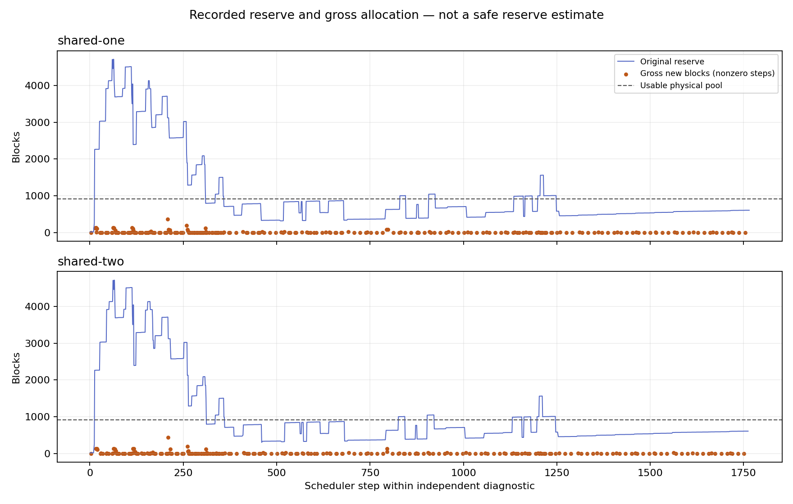

# 匿名结构：实际物理分配诊断

2026-10-13，保持原输入、参数和reserve的独立one/two两格均通过逐步身份、原回执、generation/server END及资源审计。原无探针pilot仍为3/4，formal未启动；本诊断不是性能实验。

## 结果

| 指标 | one | two |
|---|---:|---:|
| 调度步 | 1,766 | 1,763 |
| 成功新分配块总量（gross） | 3,219 | 3,337 |
| 有新分配的步数 | 232 | 234 |
| 零计算token但有新分配的步数 | 1 | 0 |
| reserve有定义的步数 | 1,743 | 1,740 |
| reserve超过909可用块的步数 | 450 | 456 |
| 其中实际有新分配 | 113 | 114 |
| 最大reserve | 4,712 | 4,712 |
| 单步最大gross新分配 | 368 | 432 |
| gross新分配超过当步已知reserve | 0 | 0 |
| 保护提交/原回执 | 1/1 | 1/1 |

one第794步在free909/reserve628时，计算token为0但成功分配83块。这是本轮真实模型服务的物理分配记录，不能用decode/计算token数代替容量需求。two没有这样的整步，不代表其没有异步回载：回载分配可能与其他请求的计算同处一步。

两个极值不一定出现在同一步；图表和逐步原始值用于描述本轮。没有观察到gross超过reserve，**不是reserve安全上界证明**。gross不包括GPU前缀命中的touch，也不是净消耗或峰值占用；已有引用、free、原生in-flight保留和后续准入都会影响可用容量。两格有观测开销，不能因果解释原无探针pilot的零覆盖，也不能用其提交成功替代原失败。

## 实现与验证

仅在245项源上增加allocation connector/runner/auditor，冻结248项源。prepare与build_connector_meta之间包装真实get_new_blocks，保留成功返回对象及原异常；记录成功调用IDs、free变化、实际usable容量和步编号。零token也结束观测边界；边界外分配或未结束上一步直接报错。未改策略、reserve和输入。

审计要求每个窗口恰好一个allocation记录，编号连续、时间不跨下一步、free/reserve一致、IDs唯一且数量等于空闲队列消费。两格全部通过。本地审计/分类9 passed、依赖缺失1文件skipped；远端真实BlockPool观测器4项及审计6项合计10 passed、66条依赖弃用warning。没有重跑历史961项CUDA/native基线。

另外完成真实KVCacheManager容量契约8项：0计算/64外部tokens分配4块；64token空闲GPU命中加1新token只新分配1块却消耗5空闲块；若命中块已有owner则只消耗1块；混合32本地/32外部命中消耗4块但新分配2块。原生reservation、watermark和完整序列门槛均不能省略。首次测试误将固定版三个返回值按两个解包，3 failed/5 passed；修正测试后8 passed，失败日志保留。详见后续原生准入边界设计，不能把单调用契约外推成整步预测。

## 证据与复现

- [原始包](evidence/shared-structure-allocation-evidence.tar.gz)：51文件、191,522,449原始bytes，压缩9,251,278bytes；SHA256 `a74d27f00a6aba8d4eb8ccb617bc5a64daa16c78aad75e07aed9f9b19cb05142`。
- [审计摘要](evidence/shared-structure-allocation-summary.json)、[完整性复算](evidence/shared-structure-allocation-integrity.json)、[分析数据](evidence/shared-structure-allocation-analysis.json)。完整17MB逐条audit及原始事件在包中，避免在Git重复存放展开数据。
- 服务器、本地、248项冻结源报告完全相等；原始inventory逐字节核验通过。
- `python docs/experiments/2026-10-13/verify_shared_structure_allocation.py <archive> <new-directory>`。
- 展开audit后运行`analyze_structure_allocation.py <audit.json> --output <directory>`复现图表。

下一步研究**原生单次准入的容量边界**：复用已经确定本地/外部命中的native需求语义，先只读记录、再建立契约。不得直接以本图实际分配或历史分位数替代全步reserve；原策略及formal门槛不变。
